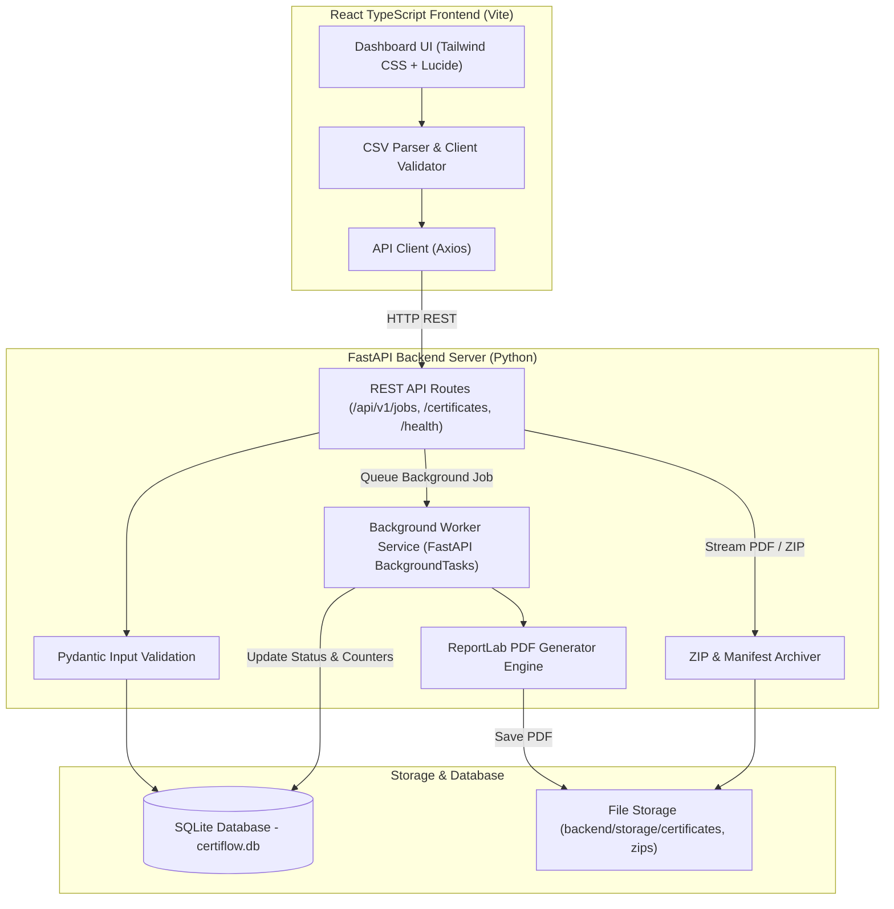

# CertiFlow — Production-Quality Bulk Certificate Generation Platform

> **Tagline**: *"From attendee lists to certified achievements."*

CertiFlow is a full-stack, production-minded bulk PDF certificate generation platform built with a Python **FastAPI** backend and a **React TypeScript** frontend styling with **Tailwind CSS**. It enables organization admins and event organizers to upload large recipient lists (via CSV or JSON), perform client and server-side validation, generate personalized landscape A4 PDF certificates asynchronously, isolate individual failures, track real-time job progress, retry failed items idempotently, and download individual certificates or ZIP archives containing all generated outputs.

---

## 🏗️ Architecture & Component Design



---

## ✨ Key Features

1. **Bulk Job Dispatch & Processing**: Accepts batches of up to 500 recipients in a single request and delegates processing to background workers without blocking HTTP responses.
2. **Failure Isolation**: If one recipient's certificate generation encounters an exception, processing continues uninterrupted for all remaining recipients.
3. **Real-time Progress Tracking**: Live-updating progress bars poll persisted backend counters (`total`, `processed`, `successful`, `failed`).
4. **Idempotent Retries**: Failed recipients can be retried with a single click without re-generating previously successful certificates or creating duplicate records.
5. **CSV Drag-and-Drop Parser & Inspector**: Interactive client-side CSV validator highlights empty rows, malformed emails, and duplicate recipients prior to submission.
6. **ReportLab Landscape A4 Generator**: Custom PDF generator with double indigo borders, crisp typography, issue/expiry dates, signature lines, and unique verification IDs.
7. **ZIP Archive & Manifest Export**: Downloads all successful certificates for a job in a single ZIP file with an embedded `manifest.json`.
8. **Secure Download Pipeline**: Resolves filesystem paths safely and prevents path traversal attacks.

---

## 🛠️ Technology Stack

* **Backend**: Python 3.11+, FastAPI, Pydantic V2, SQLAlchemy 2.0 ORM, SQLite, ReportLab, Pytest, Uvicorn.
* **Frontend**: React 18, Vite, TypeScript, Tailwind CSS, Lucide React Icons, Recharts.

---

## 📁 Directory Structure

```
certiflow/
├── backend/
│   ├── app/
│   │   ├── api/
│   │   │   └── v1/
│   │   │       ├── jobs.py          # Job creation, progress, retry, zip download
│   │   │       ├── certificates.py  # Certificate catalog & PDF retrieval
│   │   │       └── health.py        # System health & DB connectivity
│   │   ├── core/
│   │   │   └── config.py            # Environment settings & storage paths
│   │   ├── db/
│   │   │   └── session.py           # SQLAlchemy engine & SQLite session
│   │   ├── models/
│   │   │   ├── job.py               # GenerationJob ORM model & status enum
│   │   │   └── certificate.py       # Certificate ORM model
│   │   ├── schemas/
│   │   │   ├── job.py               # Pydantic request/response validation schemas
│   │   │   └── certificate.py       # Certificate response schemas
│   │   ├── services/
│   │   │   ├── pdf_generator.py     # ReportLab PDF template engine
│   │   │   └── job_service.py       # Async job execution & retry logic
│   │   ├── tests/
│   │   │   └── test_api.py          # Pytest suite (15 automated test cases)
│   │   └── main.py                  # FastAPI app entry point & CORS
│   ├── storage/                     # Isolated PDF & ZIP storage
│   ├── requirements.txt             # Python dependencies
│   └── .env.example                 # Backend environment example
├── frontend/
│   ├── src/
│   │   ├── components/              # Sidebar, Header, StatusBadge, PDFPreviewModal
│   │   ├── layouts/                 # Dashboard Layout
│   │   ├── pages/                   # Overview, CreateJob, JobDetail, Library, ApiDocs, Settings
│   │   ├── services/                # Axios API client wrapper
│   │   ├── types/                   # TypeScript interfaces
│   │   ├── App.tsx                  # Main App routing
│   │   └── main.tsx                 # Vite entry point
│   ├── package.json                 # Frontend dependencies
│   ├── tailwind.config.js           # Tailwind styling configuration
│   └── vite.config.ts               # Vite build configuration
└── README.md                        # Documentation
```

---

## ⚡ Quick Start & Setup Guide

### 1. Prerequisites
* **Python**: Version 3.11 or higher
* **Node.js**: Version 18 or higher (npm v9+)

---

### 2. Backend Setup

```bash
# 1. Navigate to backend directory
cd backend

# 2. Create and activate a virtual environment (optional but recommended)
python -m venv venv
# On Windows:
venv\Scripts\activate
# On macOS/Linux:
source venv/bin/activate

# 3. Install Python dependencies
pip install -r requirements.txt

# 4. Copy environment configuration
cp .env.example .env

# 5. Start the backend development server
python -m uvicorn app.main:app --reload --host 127.0.0.1 --port 8000
```

The backend server will run at `http://127.0.0.1:8000`.  
OpenAPI Swagger documentation is available at `http://127.0.0.1:8000/docs`.

---

### 3. Frontend Setup

```bash
# 1. Open a new terminal and navigate to frontend directory
cd frontend

# 2. Install Node packages
npm install

# 3. Start Vite development server
npm run dev
```

The dashboard will be available at `http://localhost:5173`.

---

## 🧪 Automated Testing

The backend includes a comprehensive test suite written with `pytest` and `FastAPI TestClient`.

### Run Automated Tests:
```bash
cd backend
pytest -v
```

### Verified Scenarios (15/15 Passed):
1. `test_create_valid_job`: Submitting valid bulk job returns HTTP 202 Accepted.
2. `test_reject_missing_fields`: Rejects payload missing event or issuer details (422).
3. `test_reject_malformed_email`: Rejects malformed recipient email addresses (422).
4. `test_reject_empty_recipient_list`: Rejects jobs with zero recipients (422).
5. `test_generate_pdf_service`: Verifies ReportLab PDF creation and non-zero byte output.
6. `test_verify_pdf_readability`: Asserts valid `%PDF-` binary header in output files.
7. `test_get_job_status_and_progress`: Verifies persisted job metadata and recipient counts.
8. `test_failure_isolation`: Verifies that one failing recipient results in `COMPLETED_WITH_ERRORS` without terminating other recipients.
9. `test_retry_failed_recipients`: Re-queues only failed recipients without creating duplicate records.
10. `test_download_individual_certificate`: Downloads individual PDF certificate (200 OK, `application/pdf`).
11. `test_download_job_zip`: Downloads ZIP archive of all successful certificates (200 OK, `application/zip`).
12. `test_missing_job_id_404`: Returns HTTP 404 for unknown job ID.
13. `test_missing_certificate_download`: Returns HTTP 404 for missing certificate file.
14. `test_duplicate_emails_in_job`: Rejects requests containing duplicate emails within the same payload (400).
15. `test_health_check_and_status_transitions`: Verifies `/health/` returns `healthy` and DB ping succeeds.

---

## 📖 REST API Documentation

| Endpoint | Method | Description |
| :--- | :--- | :--- |
| `/api/v1/jobs/` | `POST` | Submit bulk certificate generation job |
| `/api/v1/jobs/` | `GET` | List all jobs with pagination and search |
| `/api/v1/jobs/{job_id}/` | `GET` | Retrieve job metadata and recipient details |
| `/api/v1/jobs/{job_id}/recipients/` | `GET` | List recipient results for a specific job |
| `/api/v1/jobs/{job_id}/retry-failed/` | `POST` | Retry failed recipients for a job |
| `/api/v1/jobs/{job_id}/download/` | `GET` | Download ZIP archive of successful certificates |
| `/api/v1/certificates/` | `GET` | Search and filter generated certificate library |
| `/api/v1/certificates/{id}/download/` | `GET` | Download or preview individual PDF certificate |
| `/health/` | `GET` | Application health and database status |

---

## 🏛️ Technical Design Decisions & Production Considerations

### 1. In-Process Background Tasks vs. Distributed Worker Queue
For local development simplicity and zero external dependencies, job processing utilizes FastAPI's `BackgroundTasks`. 
* **Trade-off**: In-process background tasks run inside the web server process. If the server restarts during execution, in-flight background tasks are terminated.
* **Production Migration Path**: In a production environment, `process_job_background` can be decoupled into a dedicated Celery or RQ worker queue backed by Redis or RabbitMQ without altering the HTTP route signatures or database models.

### 2. Path Traversal & File Download Security
All stored certificates are retrieved through `/api/v1/certificates/{id}/download/`. The application resolves target file paths against `STORAGE_DIR.resolve()`. If a requested path is located outside the designated storage root, the request is blocked immediately with an HTTP 403 Forbidden response.

---

## 🚀 How to Publish to GitHub

To push this repository to GitHub:

```bash
# 1. Initialize Git repository
git init

# 2. Add files and commit
git add .
git commit -m "Initial commit: CertiFlow Bulk Certificate Platform"

# 3. Create a public repository on GitHub, then link remote
git remote add origin https://github.com/YOUR_USERNAME/CertiFlow.git

# 4. Push to main branch
git branch -M main
git push -u origin main
```
